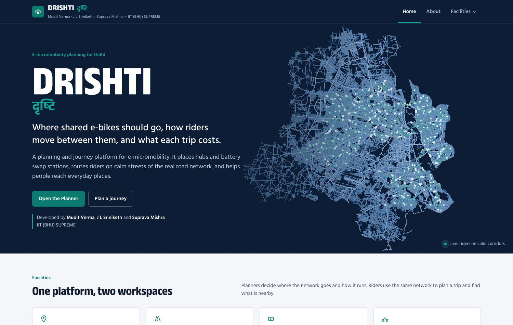
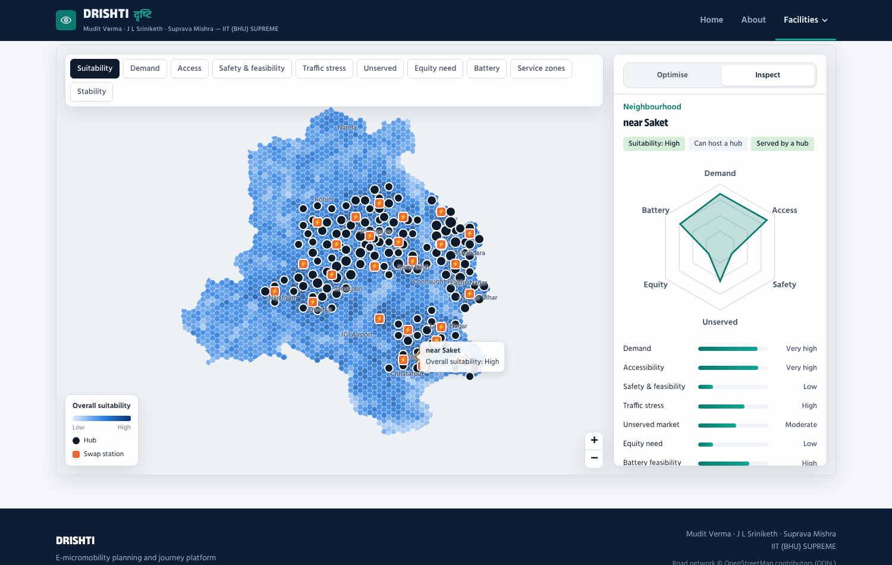
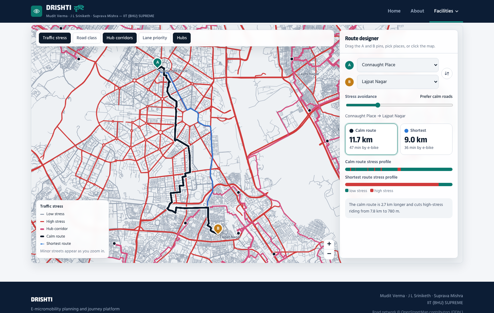
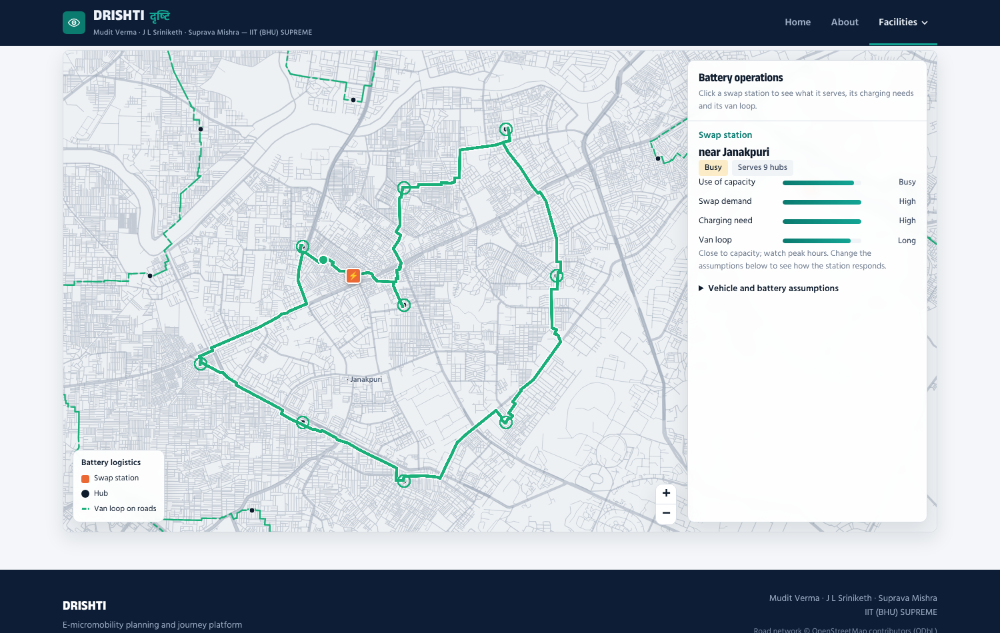
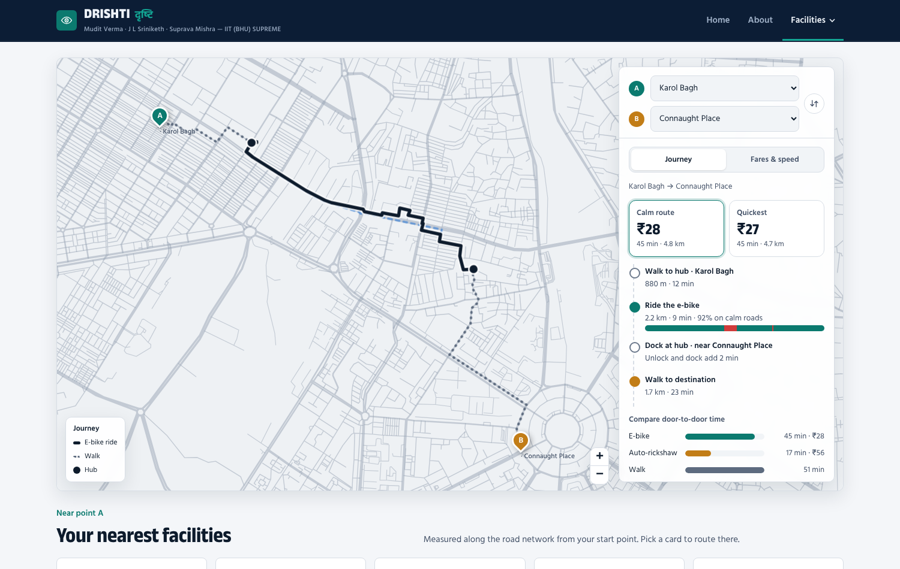

<div align="center">

# DRISHTI · दृष्टि

**E-micromobility planning and journey platform for Delhi**

Where shared e-bikes should go, how riders move between them, and what each trip costs.

[**Live demo**](https://YOUR-USERNAME.github.io/drishti/) · [Methodology deck](docs/DRISHTI_Methodology_Summary.pptx) · [Full deck](docs/DRISHTI_Methodology_Full.pptx)

Team **IIT (BHU) SUPREME** — Mudit Verma · J L Sriniketh · Suprava Mishra

</div>



## The problem

Short trips are most common in dense neighbourhoods, but those are also the places with the least shared e-bike service, the least safe riding space and the heaviest traffic. E-bikes also need frequent battery swaps, so without a planned swap network an operator cannot spread beyond a few zones.

**Research question:** How should a shared e-micromobility service provider locate its hubs, battery-swap stations and riding corridors to capture the most short-trip demand that is safe and practical to serve?

## What DRISHTI does

| Workspace | For | What you can do |
|---|---|---|
| **Planner · Suitable locations** | Operators, city agencies | Score every neighbourhood, place hubs with an exact optimisation, change weights and re-place hubs live, compare scenarios, hover a hub to see the area it serves |
| **Planner · Road network & routes** | Operators, traffic planners | Drag A/B pins to compare the calm route with the shortest one on the real road network, see each route's stress profile, view hub corridors and lane priorities |
| **Planner · Battery & stations** | Operators | Click a swap station to see the hubs it serves, its load and charging need, and an animated van loop along the roads |
| **User · Journey planner** | Riders | Walk → ride → walk routing with calm and quickest options, fare and time, comparison with auto-rickshaw and walking, and nearest facilities by road |

| Suitable locations | Road network & routes |
|---|---|
|  |  |
| **Battery & stations** | **Journey planner** |
|  |  |

## How it works

```
 hex grid + indicators ─┐
                        ├─► 1. road graph ─► 2. simplify ─► 3. score + optimise ─► 4. compress roads ─► 5. build index.html
 OSM road network ──────┘
```

1. **Road graph** – OpenStreetMap ways are split at shared vertices into a junction graph; the largest connected network is kept.
2. **Simplify** – chains of the same road class and stress are merged and geometry simplified.
3. **Score and optimise**
   - Seven sub-indices per neighbourhood: demand, accessibility, safety & feasibility, traffic stress, unserved market, equity, battery feasibility.
   - **Hub siting:** maximal covering location model (MCLP) solved exactly with HiGHS; a hub serves areas within a set road distance.
   - **Swap stations:** capacitated p-median on road distance.
   - **Calm corridors:** least-cost paths where cost = length × (1 + stress penalty) × road-class factor.
   - **Van loops:** nearest-neighbour + 2-opt tours on road distance.
   - **Robustness:** the model is re-solved under four weighting scenarios.
4. **Compress roads** – the routable graph is packed into a gzip binary for the browser.
5. **Build** – model outputs, the road graph and the web template become one self-contained `index.html`. Routing (Dijkstra / A*) and re-optimisation run live in the browser; no server is needed.

**Tech:** Python (GeoPandas, SciPy, NetworkX, PuLP + HiGHS, pyproj) · Leaflet · vanilla JavaScript · Canvas rendering.

## Run it

### Just view it
Open `index.html` in a browser, or use the live demo link above.

### Rebuild from data
```bash
pip install -r requirements.txt
# put the input files in data/ (see data/README.md)
bash run_pipeline.sh          # steps 1–5, about 10–15 minutes
```

## Repository structure

```
├── index.html               # the built web app (served by GitHub Pages)
├── web/                     # source of the web app
│   ├── template.html        # pages, styles and app logic
│   ├── engine.js            # road-graph loader, routing, canvas road layer
│   └── leaflet.css
├── pipeline/                # data processing and optimisation (run in order)
├── data/                    # input data (not committed, see data/README.md)
├── docs/                    # methodology decks
└── assets/screenshots/
```

## Team

**IIT (BHU) SUPREME** — Mudit Verma · J L Sriniketh · Suprava Mishra

## Acknowledgements

Road network © OpenStreetMap contributors, available under the Open Database Licence (ODbL).
